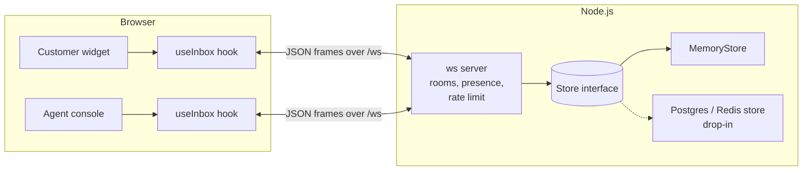
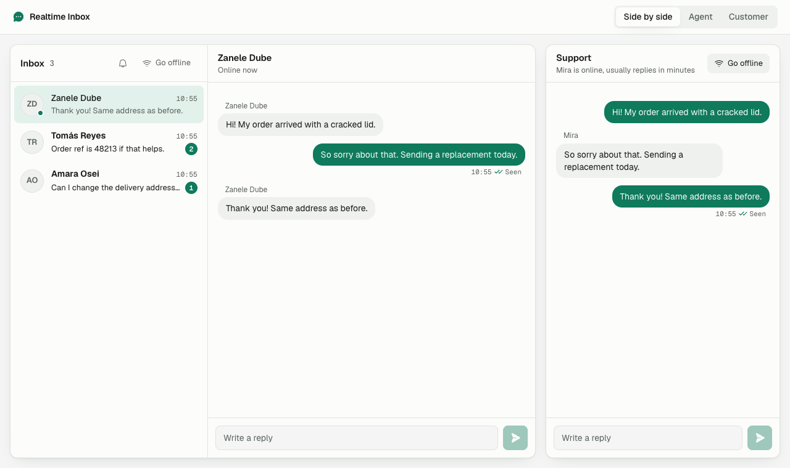
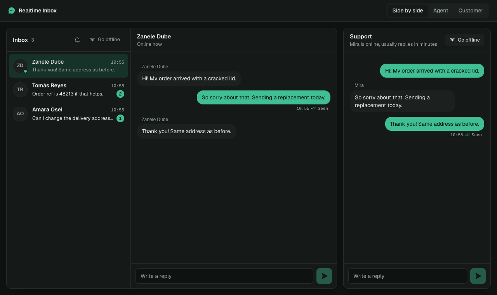

# Realtime Inbox

A small real-time support inbox: a Node.js WebSocket server and a React client with an **agent console** and a **customer widget**. It covers the parts that usually go wrong in chat: message ordering, reconnecting without losing or duplicating messages, optimistic sends, read receipts, typing and presence.


The GIF shows a customer message arriving in the agent inbox, the agent replying (customer sees **Seen**), then the customer going offline, writing a message anyway, and coming back online. The queued message is delivered exactly once.

## Why

I built a production support Message Center (WebSockets + Node.js APIs) at a previous job. This is a clean-room, deliberately small version of the same problem, written to show the protocol decisions in about 1,000 lines of TypeScript instead of a framework.

## Quick start

```bash
pnpm install
pnpm dev        # server on :8787, client on http://localhost:5180
pnpm test       # server protocol tests + client hook tests
```

Open http://localhost:5180 for the side-by-side demo. `#/agent` and `#/widget` mount each view alone; open `#/widget` in a second browser to start another conversation (each browser gets its own customer id). Two seeded conversations make the inbox non-empty on first run.

## Architecture



| Path | What lives there |
| --- | --- |
| `shared/protocol.ts` | Every frame type, shared by both sides. The contract. |
| `server/src/server.ts` | Socket handling: hello, rooms per conversation, presence, token-bucket rate limit, validation. |
| `server/src/store.ts` | `Store` interface + `MemoryStore`. Owns sequencing and dedupe, so a DB store gets them by implementing 6 methods. |
| `client/src/inbox.ts` | `useInbox` hook: connection, backoff, resume, outbox, ack timeouts. State lives in a pure reducer. |
| `client/src/*.tsx` | Agent console, customer widget, shared thread. |

## Protocol

Every frame is a JSON object with a `t` field.

**Client to server**

| Frame | Fields | Meaning |
| --- | --- | --- |
| `hello` | `userId, name, role` | First frame. Agents join every conversation room; a customer joins only `conv_<userId>`. |
| `join` | `conv, since` | Subscribe and fetch messages with `seq > since`. This is the resume step. |
| `send` | `conv, clientId, body` | Post a message. `clientId` is chosen by the client and reused on retry. |
| `typing` | `conv, on` | Typing started or stopped (throttled to one "on" every 2s). |
| `read` | `conv, seq` | I have read up to `seq`. |

**Server to client**

| Frame | Fields | Meaning |
| --- | --- | --- |
| `welcome` | `conversations, online` | Reply to `hello`: visible conversations and who is online. |
| `history` | `conv, messages` | Reply to `join`: the gap since the client's last seq. |
| `ack` | `clientId, msg` | Your send was stored. Same `msg` if you sent the same `clientId` twice. |
| `message` | `msg` | Someone else posted in a room you are in. |
| `typing` | `conv, userId, name, on` | Clients expire it after 4s if no "off" arrives. |
| `read` | `conv, userId, seq` | Read receipt, clamped to the conversation's last seq. |
| `presence` | `userId, online` | First connection opened or last one closed. |
| `conversation` | `conversation` | A new customer started a conversation (agents only). |
| `error` | `code, message, clientId?` | `bad_frame`, `not_hello`, `forbidden`, `rate_limited`, `too_long`. With `clientId`, that message is marked failed. |

### Delivery guarantees

- **Ordering.** The store gives each conversation a gap-free `seq` starting at 1. Clients sort by `seq`, never by arrival time or clock.
- **No duplicates.** The store keys messages by `(conv, clientId)`. A retried send returns the original message and is not broadcast again. The client merges by message id, so a late ack after a resumed `history` is harmless.
- **No lost messages.** On reconnect the client sends `join { since: lastSeq }` for each room, then flushes its outbox. Anything sent while offline stays queued as *Sending*; anything not acked within 8s while connected turns *Not delivered* with a Retry button that reuses the same `clientId`.
- **Reconnect.** Exponential backoff with jitter, capped at 8s.

## Tests

`server/test/protocol.test.ts` runs a real `ws` server on a random port with real sockets:

- 40 interleaved sends from two clients get seq 1..40, and both clients rebuild the same ordered log
- a duplicate `clientId` is stored and broadcast once
- a dropped customer resumes with `since` and gets exactly the missed messages
- typing and read receipts reach the room but not the sender; reads clamp to the last seq
- a customer cannot join another customer's conversation
- the rate limit rejects the right message, by `clientId`

`client/src/test/inbox.test.ts` covers the reducer (merge, unread counts, optimistic replacement) and drives `useInbox` against a fake WebSocket with fake timers: offline queueing, resume with `since`, outbox flush, ack timeout and retry with the same `clientId`, typing expiry.

## Screenshots

| Light | Dark |
| --- | --- |
|  |  |

Mobile: inbox, conversation, widget.


## Trade-offs and what I would add for production

- **Identity is self-declared** in `hello`. Production verifies a session token or signed JWT at the upgrade request and derives `userId` and `role` from it.
- **One process.** Rooms and presence live in memory. To scale out, put a pub/sub (Redis, NATS) between nodes for room fan-out and presence, and keep `seq` assignment in the database (a per-conversation counter or a sequence column).
- **In-memory store, unbounded history.** `join` returns the whole gap. A DB store would page it and the client would load older messages on scroll.
- **Rate limit is per connection.** Per user or per IP needs shared state too.
- **Read receipts are a high-water mark**, not per message. That is what support tools need and it stays O(1).
- **No delivery receipts to other devices of the same user.** Multiple tabs work (presence counts connections), but each tab owns its own outbox.
- **Notifications** use the browser Notification API while the tab is hidden, plus an unread count in the title. Push notifications for closed tabs would need a service worker and a push service.

## Stack

Node.js 22, TypeScript, [`ws`](https://github.com/websockets/ws), React 19, Vite, Vitest, Testing Library, Phosphor icons, Geist. No UI framework, no state library.

## License

MIT, see [LICENSE](LICENSE). By Shubham Bhodiwal ([@shubham-bodiwal](https://github.com/shubham-bodiwal)).
